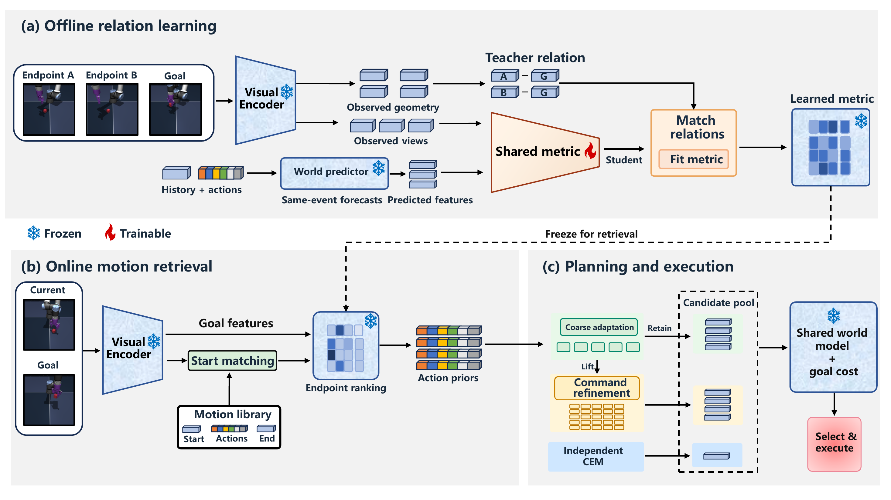

<div align="center">

# OMR: Outcome-Matched Retrieval

**Learning goal-relative motion reuse from recorded outcomes**

[Overview](#overview) · [Installation](#installation) · [Data and models](#data-and-models) · [Evaluation](#evaluation) · [Results](#results) · [中文说明](docs/README.zh-CN.md)

</div>

## Overview

A trajectory record contains actions and observations, but it does not directly reveal which recorded motion should be reused for a new visual goal. **OMR** turns the physical outcome shared by those views into retrieval supervision: the observed endpoint relation supplies the teacher, while forecasts rolled out from earlier points in the same record provide matched student views.

OMR operates with a **frozen visual world model**. The learned metric only ranks retrieval candidates; the original latent goal cost still evaluates every searched plan and selects the action sequence. Deployment uses current RGB, goal RGB, and command history. The repository also retains the recorded coarse-to-fine trajectory optimizer, independent CEM branch, and final candidate pool used by the confirmation study.

<p align="center">
  
</p>

**How it works**

1. **Anchor:** identify the same physical endpoint event from an observed record and multiple forecasts started at earlier times.
2. **Distill:** use the observed endpoint-goal relation as a soft teacher for a shared linear metric on both observed and forecast features.
3. **Retrieve:** prefilter by current RGB, rank endpoints with the frozen metric, and recover four recorded action priors.
4. **Plan and select:** adapt the priors with coarse and command-level residual search, retain all final means, and select with the original frozen goal objective.

The implementation is in [`src/omr`](src/omr). The framework is also available as a [vector PDF](assets/framework.pdf). This source distribution contains code, resources, and experiment records; no manuscript or claimed venue acceptance is included.

## Installation

The recorded experiments used **Linux, Python 3.11, PyTorch 2.8.0, CUDA 12.8**, and the pinned `stable-worldmodel` revision below. Use an isolated environment; newer planning APIs may differ.

```bash
# From this repository's root
uv venv --python 3.11 .venv
source .venv/bin/activate

uv pip install torch==2.8.0 torchvision==0.23.0 \
  --index-url https://download.pytorch.org/whl/cu128
uv pip install -r requirements.txt
uv pip install -e . --no-deps

python scripts/check_runtime.py
python scripts/verify_release.py
python tests/test_solver_parity.py
```

`requirements.txt` pins the runtime to commit `21446f1ede6d5284e981bd7b47f432b994e6d812`. The complete observed package inventory is in [`provenance/runtime-lock.txt`](provenance/runtime-lock.txt). Runtime checks compare the installed planning source hashes with the recorded versions. Linux/EGL evaluation is the supported configuration; native Windows simulator evaluation has not been validated.

Release/result verification uses only the Python standard library. The solver parity test runs on CPU with a synthetic cost and does not launch a simulator.

## Data and models

**Included in this repository**

- Four fixed trajectory banks, normalization statistics, and exact retrieval items.
- Nine frozen endpoint heads per environment: three OMR/self-distilled, three preference-reference, and three temporal-reference heads.
- Offline observation/forecast features and numeric reference targets; no label API is required.
- The exact 128 confirmation roots per environment, complete 24,576-row result matrix, fixed confidence intervals, and evidence hashes.

**External inputs:** original HDF5 datasets and four matching frozen world-model checkpoints. Dataset preparation and checkpoint compatibility are described in [Reproducibility](docs/REPRODUCIBILITY.md). A companion checkpoint archive may be supplied separately; unpack it at the repository root. Checkpoint identities are recorded in [`configs/experiment.json`](configs/experiment.json).

```text
external_data/                  # Dataset files, downloaded separately
├── pusht_expert_train.h5
├── tworoom.h5
├── reacher.h5
└── ogbench/cube_single_expert.h5

checkpoints/                    # Exact checkpoint SHA required
└── <environment>/weights_epoch_10.pt
```

Public checkpoints with a different SHA are not interchangeable with the models behind the reported results. Optional guide refitting is deterministic CPU work on bundled features; it makes zero online model/API requests.

## Evaluation

Validate inputs without launching an environment:

```bash
python scripts/evaluate.py \
  --environment pusht \
  --data-root external_data \
  --checkpoint checkpoints/pusht/weights_epoch_10.pt \
  --check-only
```

Run OMR on all 128 roots, all three bundled OMR heads, and both planning seeds:

```bash
export CUDA_VISIBLE_DEVICES=0
export MUJOCO_EGL_DEVICE_ID=0
export MUJOCO_GL=egl
export SDL_VIDEODRIVER=dummy
export OMP_NUM_THREADS=2 OPENBLAS_NUM_THREADS=2 MKL_NUM_THREADS=2

nice -n 10 python scripts/evaluate.py \
  --environment pusht --method omr --budget high \
  --data-root external_data \
  --checkpoint checkpoints/pusht/weights_epoch_10.pt \
  --output runs/pusht_omr
```

Run the complete registered confirmation matrix for one environment:

```bash
nice -n 10 python scripts/evaluate.py \
  --environment cube --suite high \
  --data-root external_data \
  --checkpoint checkpoints/cube/weights_epoch_10.pt \
  --output runs/cube_all
```

The complete matrix has **24 configurations x 2 planning seeds x 128 roots = 6,144 episodes per environment**. Outputs must use a new directory; the runner never overwrites or silently resumes recorded results. `--root-count 1` is an integration check, not a replacement for the full result. No scheduler or remote-control process is started by installation.

Each episode stores selected plans, final candidates where applicable, executed actions, audit states, model-call counts, elapsed time, and a JSON result row. Simulator state is used for reset/audit only; the policy receives RGB inputs.

### Optional offline metric fitting

```bash
python scripts/train_guide.py \
  --environment pusht --kind self_search --seed 2131 \
  --device cpu --output runs/metric_refit/pusht_2131.pt
```

This refits the bundled objective on included observation/forecast features. A refitted metric is a new artifact and does not automatically replace a frozen evaluation head.

## Results

The primary table comes from the complete independent confirmation. Each environment uses 128 new roots, planning seeds 8301/8302, and all three OMR heads. The world model is fixed per environment; at most 50 commands are executed per episode.

| Environment | OMR success (%) | Root-cluster 95% CI |
|:--|--:|:--|
| TwoRoom | **97.40** | [94.66, 99.48] |
| PushT | **91.02** | [86.98, 94.53] |
| Cube | **86.46** | [81.51, 91.02] |
| Reacher | **85.55** | [81.12, 89.71] |
| **Four-task mean** | **90.10** | [88.09, 91.99] |

The complete evaluation contains **24,576 episodes** and 519,998 executed commands. It includes OMR, geometric observed-only retrieval, preference and temporal reference guides, coarse/direct/retention controls, matched CEM, and retrieval-only planning. Original-precision records are in [`results/all_methods.csv`](results/all_methods.csv); macro statistics are in [`results/all_methods_macro.csv`](results/all_methods_macro.csv). Complete per-run rows and fixed analyses are under [`results/confirmation`](results/confirmation).

External RGB-system numbers used for descriptive comparison are stored separately in [`results/published_baselines.json`](results/published_baselines.json); they were reported by the original authors and were not rerun here.

## Repository structure

```text
src/omr/           Retrieval metric, trajectory optimizer, controls, ablations
scripts/           Evaluation, offline metric fitting, input/result verification
tests/             CPU equivalence checks against the frozen solver
configs/           Registered confirmation matrix and environment reset settings
resources/         Fixed banks, metric heads, normalization, training features
results/           Complete confirmation rows, analyses, intervals, resources
assets/            Final framework and motivation figures
reference/frozen/  Original solver files, preserved for code-equivalence checks
third_party/       Checkpoint compatibility modules and upstream licenses
provenance/        Runtime inventory, source mappings, SHA manifests, validation
docs/              Reproducibility, code map, result notes, Chinese README
```

## Notes

This archive documents an unpublished research artifact. It does not claim venue acceptance. The learned retrieval metric is the OMR contribution; the residual optimizer is retained as the frozen backend used to isolate retrieval quality. The repository can be cited by artifact version rather than by a paper while the manuscript remains unpublished.
